# Greenfield rewrite pack

**What this is:** a self-contained spec + screenshot pack for rewriting Zetteldraw from scratch. The current app matches product behavior well enough, but the legacy codebase has been **unreliable** (local data loss / short overwrite / wrong-notebook paint). Tip-band bandages (v78–v86) proved the *invariants* — they did **not** prove the *codebase* is worth carving further.

**Preference (2026-10-14):** prefer a **greenfield rewrite** from these condensed docs + screenshots over continued in-place refactor of god files (`CanvasActivity`, `RoomBoardRepository`, dual board+`.zdl` paths, silent pull-heal while live).

### Implementation home

| | |
| --- | --- |
| **Implementation** | Separate Cursor Project / repo **zetteldraw rewritten** — not this legacy tree |
| **This pack** | Specs + screenshots only (`docs/greenfield/` here). Do **not** treat an in-tree `v2/` scaffold as home — that path was removed. |
| Legacy tip | Root `app/` / `server/` / `web/` stay as tip **behavior reference** only — do **not** carve them for greenfield |

---

## How to use this pack

1. Work in the **zetteldraw rewritten** Project/repo. Do **not** copy legacy tip `app/`, `server/`, or `web/` source as a starting point.
2. Keep this entire `docs/greenfield/` tree (with `media/` next to the markdown) as the acceptance + architecture pack.
3. Treat **[product-behavior.md](./product-behavior.md)** as the must-not-regress acceptance list.
4. Treat **[architecture.md](./architecture.md)** as the first-principles module map and structural impossibility rules.
5. Treat **[sync-model.md](./sync-model.md)** as the locked sync ceremony.
6. Treat **[non-goals.md](./non-goals.md)** as what **not** to port from the old tree.
7. Use the screenshots below as visual ground truth for chrome and companion layout.
8. Optionally keep tip **v86** installed on a Boox as a **reference behavior** device — click through chrome and sync flows — but **do not port that code blindly**.

### Reference tip (behavior only)

| | |
| --- | --- |
| Tip APK | https://zetteldraw.com/apk |
| Release | [v86](https://github.com/GreatTA1998/zetteldraw/releases/tag/v86) (`3.65`) |
| Role | **Reference behavior / do not port blindly.** Specs + screenshots in this pack win when they disagree with incidental tip UI thrash. |

Deeper historical argument (legacy repo): [CORRECTNESS.md](../CORRECTNESS.md), [product-behavior.md](../product-behavior.md) (if present on main).

---

## Pack contents

| Doc | Purpose |
| --- | --- |
| [product-behavior.md](./product-behavior.md) | Condensed product + must-not-regress checklist (~2–3 pages) |
| [architecture.md](./architecture.md) | Greenfield modules + structural anti-data-loss invariants |
| [sync-model.md](./sync-model.md) | Single-writer, cloud backup, Prepare / Hand off |
| [non-goals.md](./non-goals.md) | What **not** to copy from the old codebase |
| [media/](./media/) | Key screenshots (Boox chrome + web companion) |

---

## Key screenshots

### Boox — pen surface + page chrome

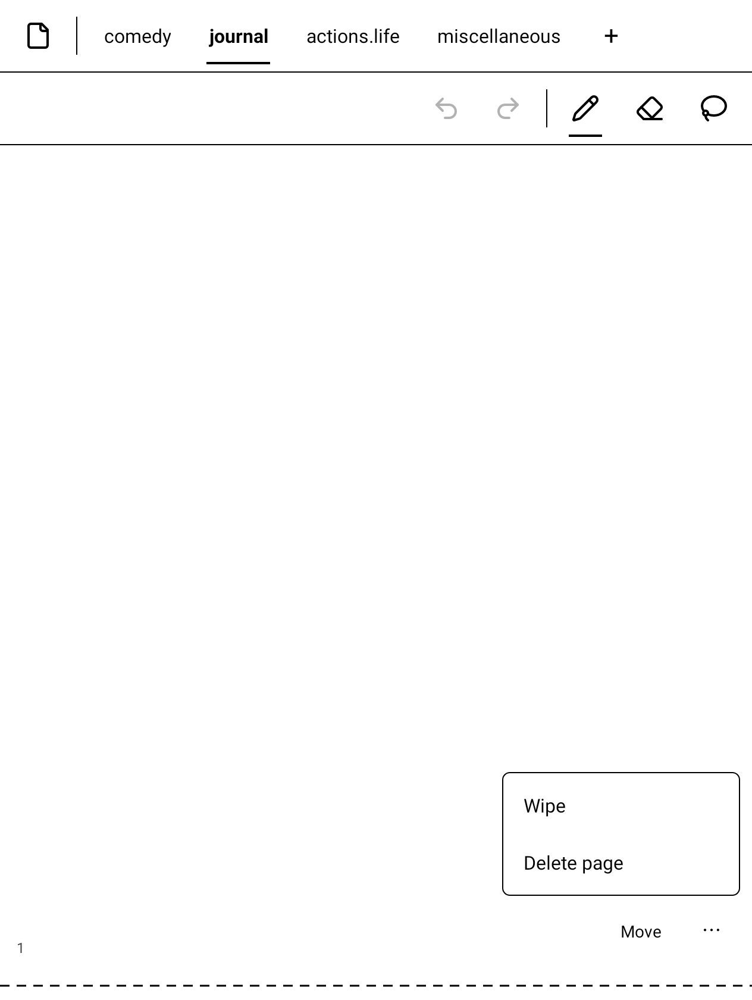

*Full-screen Boox UI: notebook tabs, tool row, continuous paper, page chrome (`k/n`, Link · Reorder, Move · ⋮).*

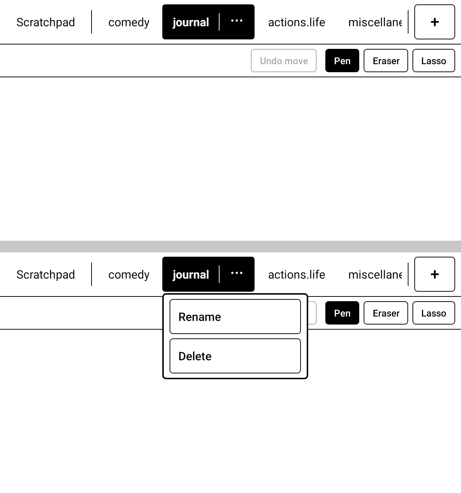

*Nested notebook tab bars (Scratchpad + top-level; child bar when a parent is selected).*

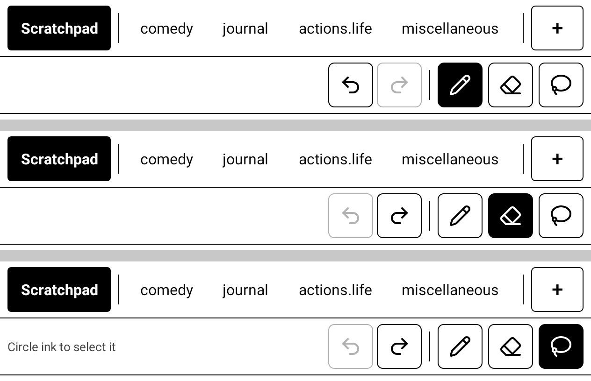

*Undo · Redo | Pen · Eraser · Lasso — active tool underline.*

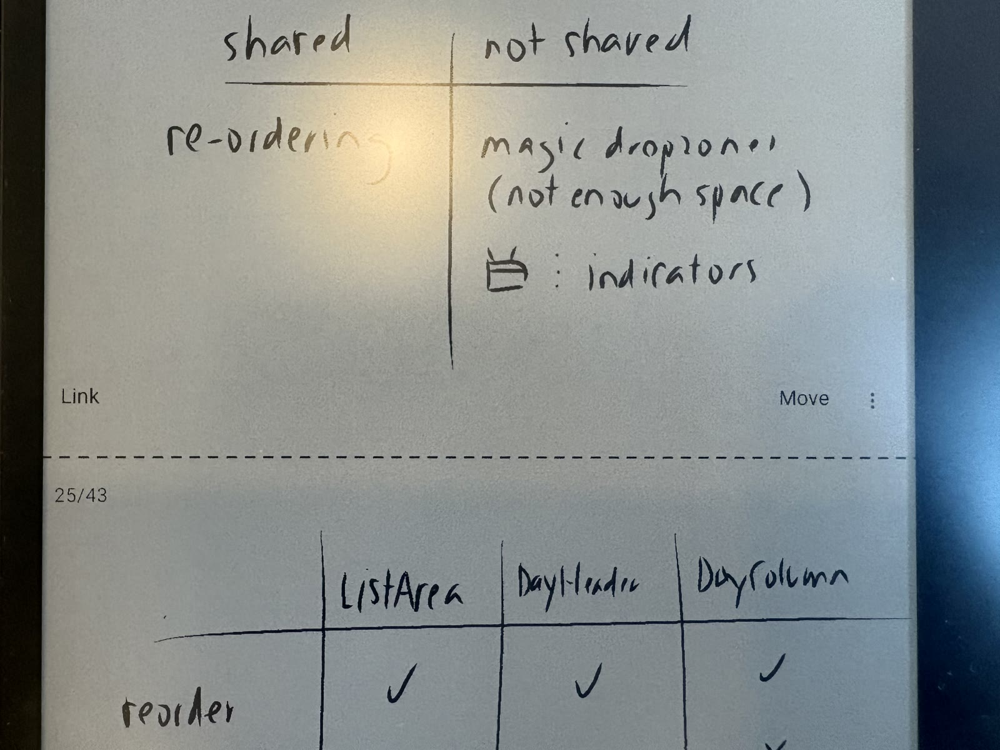

*Real-device page chrome / side margins (optical balance).*

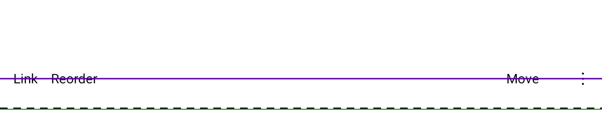

*Bottom page chrome row detail.*

### Web companion — library, hierarchy, Hand off

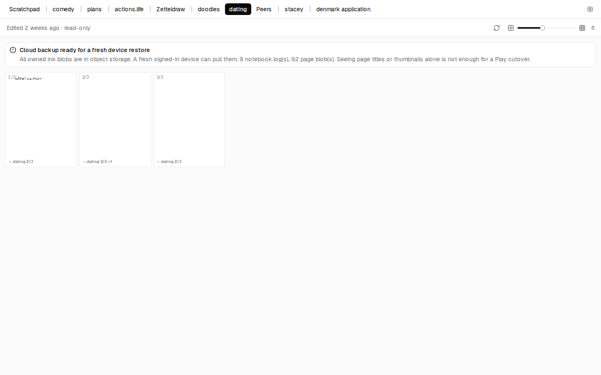

*Web dense thumbnail grid — Dating / nested library example.*

*Nested top bars mirroring Android (parent → children).*

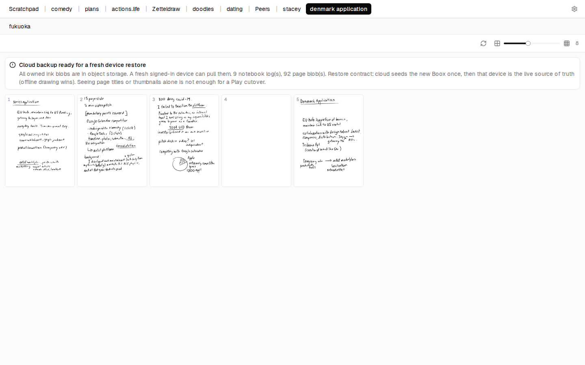

*Production nested tabs.*

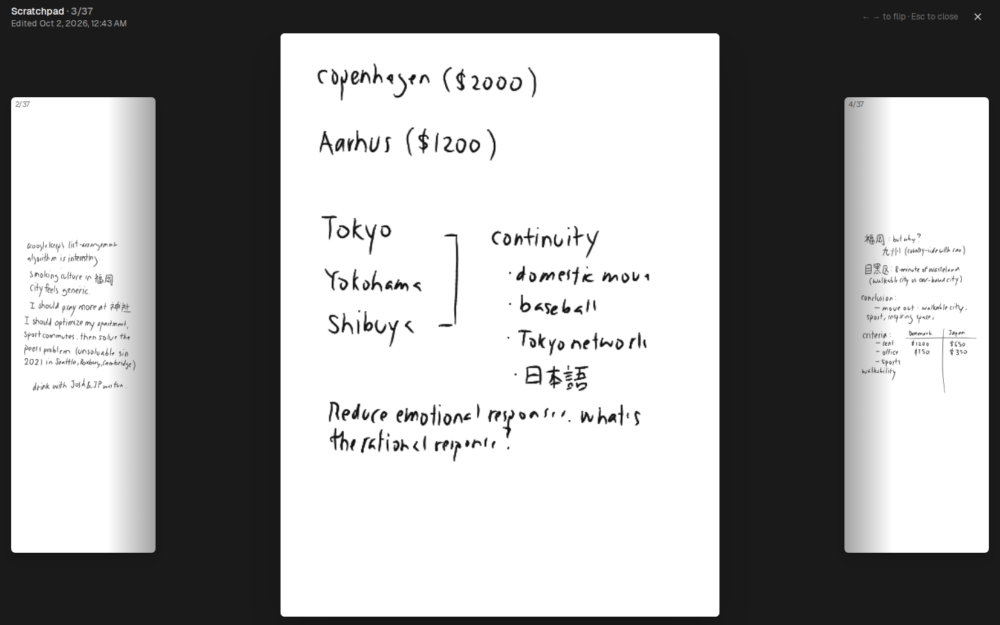

*Full-page viewer with neighbor peeks + link chips.*

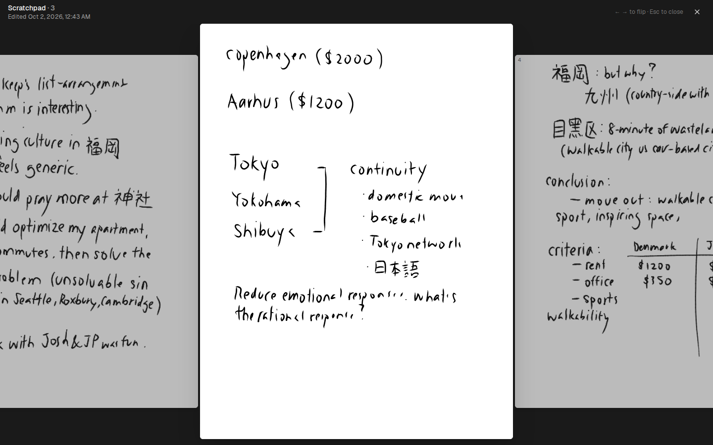

*Production viewer peeks.*

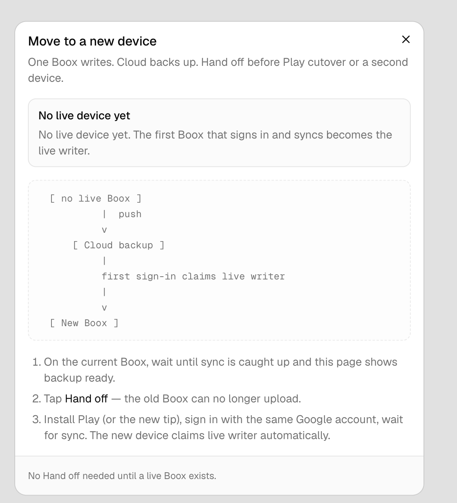

*Settings → Move to a new device / Hand off modal (blocked until Prepare transfer or lost-device).*

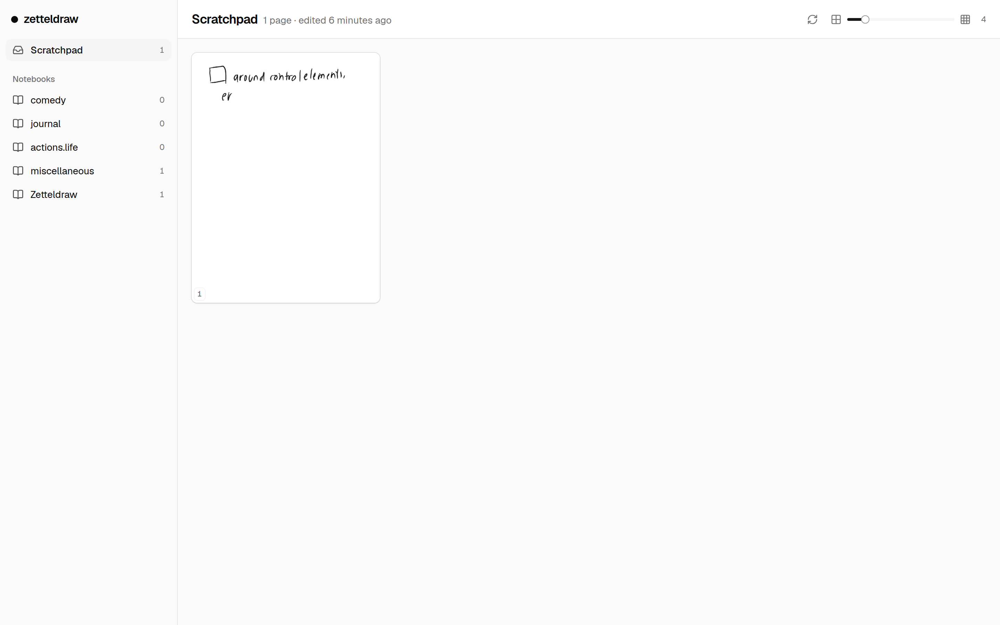

*Earlier overview of zetteldraw.com library chrome.*

---

## One sentence

Rebuild so **local ink loss, short overwrite, and wrong-notebook paint are structurally impossible** — and so a new engineer can reason about open / paint / sync without reading 13k LOC of tip bandages.
